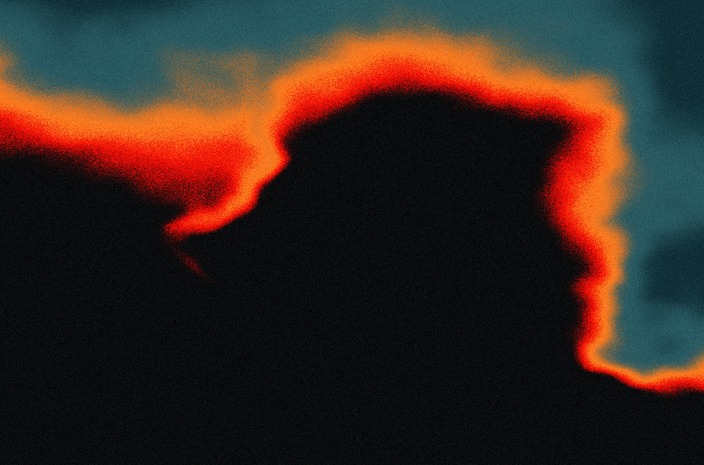

# SimplexFlame

A native macOS Metal wallpaper experiment inspired by the supplied fire-gradient image. The image is not loaded at runtime: the soft shapes, charcoal/red/orange/teal palette, and stable grain are procedural.



## Run

Requires macOS 13+ and Apple's Command Line Tools (`xcode-select --install`). No third-party dependencies or full Xcode installation required.

```sh
bash scripts/build.sh
open dist/SimplexFlame.app
```

The app opens a preview with flow speed, grain, and brightness controls. Click **Use as Wallpaper** to place the animation behind desktop icons on each connected screen. Use the **flame menu-bar icon** to reopen controls, pause, disable the wallpaper, or quit. Quitting reveals the existing wallpaper. Slider settings are remembered. It does not install a login item or change the system wallpaper image.

Check **Pomodoro · 20 Minutes** in the flame menu to enable repeating breaks. After 20 minutes of normal work, a fullscreen splash over the animated wallpaper on every display counts down from 30 seconds to zero. It then returns to your previous wallpaper/preview mode and starts the next 20-minute work interval. Double-click anywhere or press Escape to skip a break and begin the next work interval immediately. Uncheck the menu item at any time to stop the cycle and dismiss any active break. Move the pointer to the top edge to reveal the menu bar during a break. Sleep counts toward the interval; a break that becomes due during sleep appears on wake.

Pomodoro reuses the existing wallpaper views and adds a separate text overlay updated once per second during breaks. Work intervals use a single scheduled timer, with no overlay or per-second updates. When disabled, there is no running timer or overlay; the Metal shader, resolution, render passes, and frame rate are unchanged.

## Render a still

```sh
mkdir -p output
dist/SimplexFlame.app/Contents/MacOS/SimplexFlame --snapshot output/frame-0.png 0
dist/SimplexFlame.app/Contents/MacOS/SimplexFlame --snapshot output/frame-30.png 30
# Match a specific display's pixel dimensions:
dist/SimplexFlame.app/Contents/MacOS/SimplexFlame --snapshot output/display.png 30 --width 2560 --height 1600
```

The optional last argument is animation time in seconds. This uses the same Metal shader as the live app.

## Implementation

- Swift/AppKit app with an `MTKView` and fullscreen triangles.
- Four-octave gradient noise, slow domain warping, shaped warm folds, and a nonlinear color ramp in `Flame.metal`.
- Screen-anchored grain: it does not randomly flicker every frame.
- 30 fps with output matching each screen's full backing resolution, including Retina scaling. There is no 1440-pixel cap.
- Two render passes: calculate the smooth scalar flame field at one quarter of the output width/height, then interpolate it and apply the original palette and grain at full output resolution. Only the internal smooth field is approximated; the finished image is not upscaled. A padded border preserves interpolation at screen edges.
- Pauses rendering on display/system sleep and manual pause; hidden/occluded previews stop rendering.
- One click-through desktop-level window per display, joining desktop Spaces; windows rebuild when displays change.
